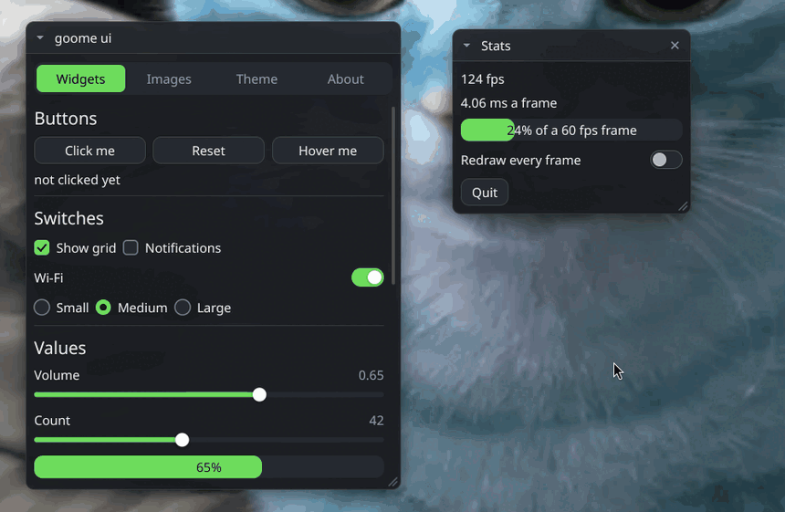
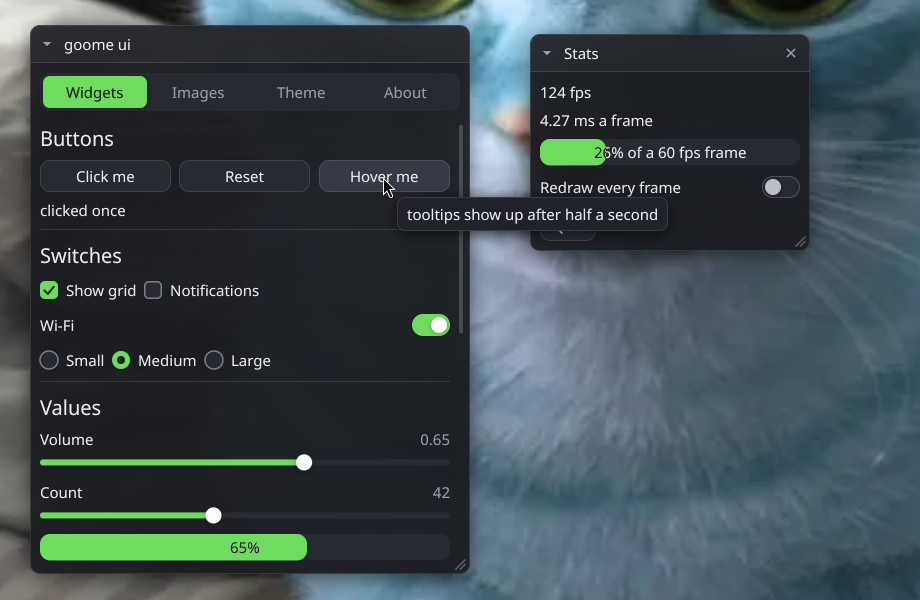

<p align="center">
  
</p>

<h1 align="center">🐍 python-goome 🐍</h1>

<p align="center">
<b>Draw see-through overlays that stay on top of everything, straight from Python.</b>
</p>

<p align="center">
  
  
  
  
  
  
</p>

<p align="center">
  These are the Python bindings for <a href="https://github.com/goome-ui/c-goome">goome</a>. You get a see-through layer over every monitor, you draw on it, and only the bits you draw take clicks.<br>
  Hotkeys, screen grabs, real fonts, images and the whole ui kit come with it. It talks to the C library through ctypes, so theres nothing to compile when you use it.<br> <br>
  Do you like this project? If so, please let me know!
  <a href="https://sevvy-wevvy.com/discord">Discord</a>
</p>

<p align="center">
  <br>
  <sub>the C ui demo running on my gnome desktop. its the same ui kit, and the Python port draws the exact same frames</sub>
</p>

<details>
<summary align="center"><b>⬇️ Install ⬇️</b></summary>

<br>

```sh
pip install git+https://github.com/goome-ui/python-goome
```

<p align="center">
Its not on PyPI (yet), so it comes straight from here. When you install it, pip builds the goome library for your computer with your C compiler. That takes a few seconds and only happens once.<br> <br>
No compiler? On Debian/Ubuntu thats <code>sudo apt install build-essential</code>, on Mac <code>xcode-select --install</code>, on Windows <a href="https://www.mingw-w64.org/">mingw-w64</a> gcc or Visual Studio (run it from the developer prompt). <code>CC</code> picks a different one.<br> <br>
The wheels from CI already have the library inside, grab one from the Actions tab and <code>pip install</code> it if you dont want to build anything.
</p>

<p align="center">
Working from a clone instead:
</p>

```sh
git clone https://github.com/goome-ui/python-goome
cd python-goome
./build.sh test      # builds goome/_native/libgoome.so and runs the tests
```

<p align="center">
Got your own libgoome somewhere? Set <code>GOOME_LIB=/path/to/libgoome.so</code> and it uses that one.
</p>
</details>

<details>
<summary align="center"><b>🚀 Quick Start 🚀</b></summary>

<br>

<p align="center">
A whole overlay that draws a box and prints clicks on it:
</p>

```python
import goome

with goome.open("my overlay") as g:
    pace = goome.Pacer(60)
    running = True
    while running:
        for ev in g.events(pace.wait()):
            if ev.type == goome.QUIT:
                running = False
            if ev.type == goome.DOWN:
                print("clicked at %.0f,%.0f" % (ev.x, ev.y))

        with g.frame(0) as c:  # monitor 0, None when theres nothing to draw on
            if c is None:
                continue
            c.round_rect(100, 100, 200, 80, 12, 0xE0202838)
            c.text(116, 128, "click me", 0xFFFFFFFF, big=True)
            c.hit(100, 100, 200, 80)  # only this part takes clicks
```

<p align="center">
Colors are plain <code>0xAARRGGBB</code> ints and every position is in logical desktop coords, same as in C.
</p>
</details>

<details>
<summary align="center"><b>🎛️ UI Kit 🎛️</b></summary>

<br>

<p align="center">
The immediate mode ui works like in C, except widgets hand you the new value back instead of taking pointers. You keep your own variables and call the widgets every frame.
</p>

```python
import goome

with goome.open("settings", no_capture=True) as g, g.ui() as ui:
    win = goome.Window(40, 40, 300)  # h 0 = fit the content
    logo = goome.Bitmap.load("logo.png")
    volume, muted, name = 0.5, False, "goome"
    running = True
    while running:
        for ev in g.events(16):
            if ev.type == goome.QUIT:
                running = False
            ui.feed(ev)
        with ui.frame(0) as c:
            if c is None:
                continue
            with ui.window("Settings", win, goome.WIN_MOVE | goome.WIN_COLLAPSE) as shown:
                if shown:
                    ui.image(logo, 64, 64, 12)
                    if ui.button("Say hi"):
                        print("hi")
                    volume = ui.slider("Volume", volume, 0, 1, "%.2f")
                    muted = ui.toggle("Muted", muted)
                    name = ui.input("Name", name)
    logo.close()
```

<p align="center">
<code>ui.changed</code> tells you if the last widget changed its value this frame, like the int the C functions return.<br>
<code>goome.Window</code> keeps a windows spot, size and open state between frames. Set <code>win.open = False</code> to hide it, <code>WIN_CLOSE</code> gives it an x that does the same.<br>
<code>ui.window</code>, <code>ui.scroll_begin</code> and <code>ui.id</code> work with <code>with</code> so the matching end always gets called. You can also just use them in an <code>if</code> and call <code>window_end()</code> / <code>scroll_end()</code> / <code>pop_id()</code> yourself.<br> <br>
<code>ui.theme</code> has every color and size from <code>goome_theme</code> as an attribute (<code>ui.theme.accent = 0xFF6FDC5F</code>), plus <code>dark()</code>, <code>light()</code> and <code>font</code>.
</p>
</details>

<details>
<summary align="center"><b>📚 The API 📚</b></summary>

<br>

<p align="center">
Everything from <a href="https://github.com/goome-ui/c-goome/blob/main/include/goome.h">goome.h</a> is in here, just pythony. Errors raise <code>goome.GoomeError</code> (or a subclass like <code>goome.Again</code> or <code>goome.NotSupported</code>) with the C error code on <code>.code</code>.
</p>

| | |
|:--|:--|
| `goome.open(title, backend=, state_dir=, no_capture=, ...)` | a `Goome`, use it with `with` or call `close()`. backend can be `goome.TEST` or `"test"` |
| `g.monitors()` | list of `Monitor` with `area`, `scale`, `pw`, `ph`, `rotation` |
| `g.events(timeout_ms)` / `g.poll(timeout_ms)` | events as `Event` objects (`type`, `x`, `y`, `button`, `dy`, `key`, `mods`, `text`, `id`, `msg`) |
| `g.begin(mon)` / `g.end(c, hits)` / `g.frame(mon)` | get a `Canvas`, draw, hand it back. `c.hit(x, y, w, h)` adds a clickable rect |
| `g.pointer()` | `(x, y, buttons)` or None |
| `g.keyboard(True)` | take the keyboard, `False` gives it back |
| `g.hotkey("alt+h", 1)` | system wide combo, comes back as a `HOTKEY` event |
| `g.capture(mon, rect)` / `g.capture_wait(...)` | an `Image`, `capture_wait` keeps trying while the stream backends warm up |
| `g.alpha_at(x, y)` | is our overlay at this spot |
| `g.control_path` / `goome.send(dir, msg)` | the control fifo |
| `goome.Pacer(fps).wait()` | how long to wait for the next frame |
| `goome.parse_combo`, `goome.now_ms`, `goome.save_ppm` | the small helpers |
| `goome.Canvas.new(w, h, stride, scale)` | a canvas with its own pixels, for drawing off screen and `blit` |
| `goome.Bitmap.load` / `from_bytes` / `from_argb` / `wrap` | images, `close()` them or use `with` |
| `goome.Font.load` / `from_bytes` / `system` | fonts, `measure(text, size)` gives `(w, h)` |
| `goome.Ui(g)` or `g.ui()` | the ui kit |
</details>

<details>
<summary align="center"><b>🎨 Drawing 🎨</b></summary>

<br>

<p align="center">
The canvas methods are the C draw functions without the <code>goome_draw_</code> part:
</p>

```python
c.rect(x, y, w, h, color)
c.rrect(x, y, w, h, 12, color)                 # one radius
c.rrect(x, y, w, h, (4, 20, 0, 33), color)     # tl tr br bl
c.rrect_grad(x, y, w, h, 12, top, bottom, sideways=False)
c.shadow(x, y, w, h, radius, blur, color)
c.circle(cx, cy, r, color); c.ring(cx, cy, r, width, color); c.arc(cx, cy, r, width, a0, a1, color)
c.poly([(80, 5), (98, 85), (40, 35)], color)
c.line(x0, y0, x1, y1, width, color); c.triangle(x0, y0, x1, y1, x2, y2, color)
c.frame(x, y, w, h, width, color)
c.rrect_line(x, y, w, h, 12, width, color)
c.erase(x, y, w, h)
c.bitmap(bmp, x, y, w, h, radius=0, tint=0xFFFFFFFF)
c.text(x, y, "built in font", color, big=True)
c.font_text(font, 20, x, y, "real font", color)
with c.clip(20, 15, 80, 50):
    ...
```

<p align="center">
<code>round_rect</code> only takes one radius, <code>rrect</code> and the other rrect ones take one or a tuple of four.<br>
<code>c.blit(other, alpha, dx, dy)</code> draws another canvas on top of this one, thats what <code>Canvas.new</code> is for.<br> <br>
<code>c.pixels</code> is a flat memoryview straight over goomes buffer (premultiplied ARGB, <code>c.stride</code> per row), nothing gets copied. Write into it and call <code>c.damage(rect)</code>. Same for <code>image.pixels</code> and <code>bitmap.pixels</code>.<br>
Got numpy? <code>numpy.frombuffer(c.pixels, numpy.uint32).reshape(c.h, c.stride)</code> works, but numpy is never needed.<br> <br>
A grab stays good until you grab that monitor again. After that touching its pixels raises, call <code>image.copy()</code> if you want to keep them.
</p>
</details>

<details>
<summary align="center"><b>🧩 Examples 🧩</b></summary>

<br>

- `examples/hello.py` - a box you can click and type into, alt+h hides it, esc or the x quits
- `examples/grab.py` - `python examples/grab.py [monitor] [x y w h] out.ppm` saves a screen grab
- `examples/ui_demo.py` - the ui kit demo with every widget, a theme editor and a stats window

Theyre ports of the C examples. On the test backend the ui demo comes out pixel for pixel the same as `examples/ui.c`.

```sh
python examples/ui_demo.py
```
</details>

<details>
<summary align="center"><b>🖥️ Where It Works 🖥️</b></summary>

<br>

<p align="center">
Same places as goome, so most Linux desktops (X11 and Wayland), Windows 10 / 11 and macOS 14+. Whats supported per desktop is in the <a href="https://github.com/goome-ui/c-goome#readme">c-goome README</a>, and <code>g.caps</code> / <code>g.can(goome.CAP_HOTKEYS)</code> tells you at runtime. On Mac stay on the main thread.
</p>
</details>

<details>
<summary align="center"><b>📸 Screenshot 📸</b></summary>

<br>

<p align="center">
  <br>
  <sub>the ui kit at full size, just floating over my wallpaper</sub>
</p>
</details>

<details>
<summary align="center"><b>🧪 Testing Without A Screen 🧪</b></summary>

<br>

<p align="center">
goome has a <b>test</b> backend that fakes a screen and plays a script of what the "user" does. Thats what all the tests here run on, no display needed:
</p>

```sh
python -m unittest        # pytest works too if you have it
```

<p align="center">
You can test your own overlay app the same way, either with env vars and no code changes:
</p>

```sh
mkdir -p shots
GOOME_BACKEND=test GOOME_TEST_SHOTS=shots/ GOOME_TEST_SCRIPT="1 click 400,300; 2 key hi\n; end 10" python myapp.py
```

<p align="center">
or straight from Python:
</p>

```python
g = goome.open(backend="test", test_script="screen 800x600 1; 1 click 120,90; end 5")
```

<p align="center">
The script format is in the <a href="https://github.com/goome-ui/c-goome#readme">c-goome README</a>. The drawing tests check the exact same pixel hashes as c-goome's own tests, on every OS.
</p>
</details>

<details>
<summary align="center"><b>🔧 Updating goome 🔧</b></summary>

<br>

<p align="center">
<code>native/goome.h</code> is copied from c-goome (<code>native/VERSION</code> has the commit). Run <code>tools/update_native.sh [c-goome folder]</code> to grab a new one, then <code>./build.sh test</code>.
</p>
</details>

<details>
<summary align="center"><b>🛠 Pull Requests 🛠</b></summary>

<br>

<p align="center">
Want to help with python-goome? Make A pull request to <b>dev</b>!<br>
Small fixes are the easiest to merge, for anything bigger open an issue first so we can talk about it. Bugs in the C side go to <a href="https://github.com/goome-ui/c-goome">c-goome</a>.<br> <br>
As long as it works and doesnt add a dependency its very likely to get accepted!<br>
Read <a href="CONTRIBUTING.md">CONTRIBUTING.md</a> before you send one.
</p>
</details>

<details>
<summary align="center"><b>⚖️ License ⚖️</b></summary>

<br>

<p align="center">
python-goome is under the <a href="LICENSE">GPL-3.0</a>.<br> <br>
<sub>
• You can use it, change it and share it<br>
• If you share something made with it, you have to share your source too, under the same license<br>
• Keep the credits
</sub><br> <br>
In short: play fair, keep it open, and give credit where it's due.
</p>
</details>

<details>
<summary align="center"><b>🩷 Donate 🩷</b></summary>

<br>

<p align="center">
<a href="https://sevvy-wevvy.com/kofi">Ko-fi</a> (Preferred)<br>
<a href="https://sevvy-wevvy.com/patreon">Patreon</a><br>
<a href="https://sevvy-wevvy.com/throne">Throne</a>
</p>
</details>
