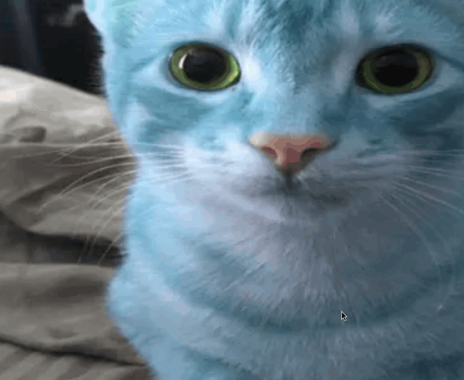
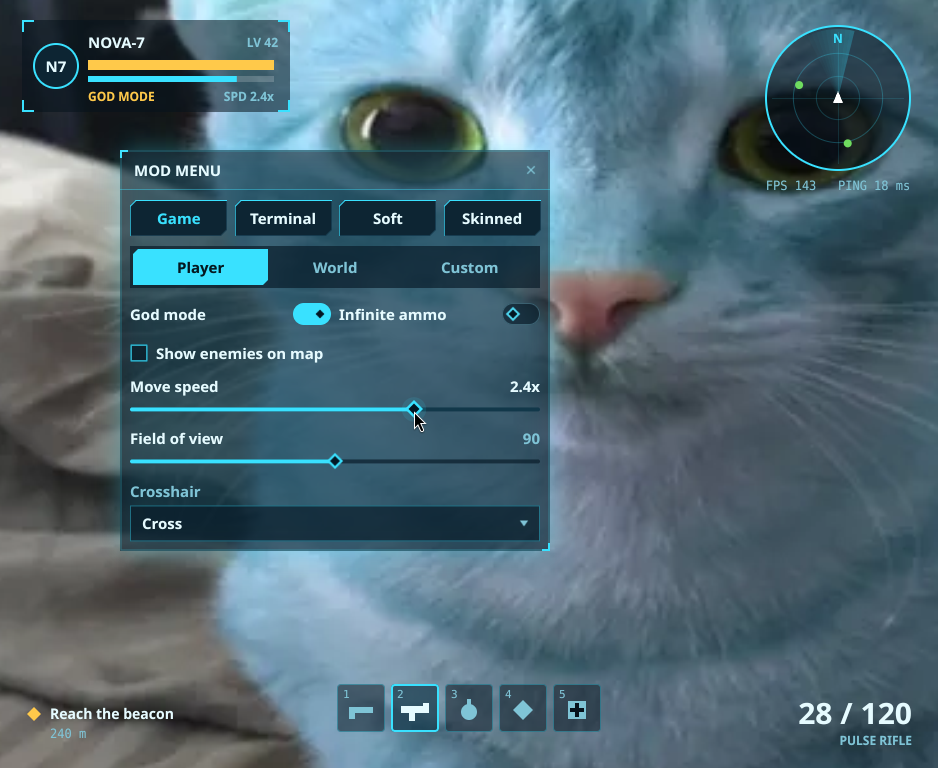

<p align="center">
  
</p>

<h1 align="center">🐍 python-goome 🐍</h1>

<p align="center">
<b>Overlays on top of everything, normal desktop apps, or ui inside your game, straight from Python.</b>
</p>

<p align="center">
  
  
  
  
  
  
</p>

<p align="center">
  <a href="https://goome-ui.github.io/docs/">Docs</a> &nbsp;·&nbsp;
  <a href="https://goome-ui.github.io/docs/builder/">Builder</a> &nbsp;·&nbsp;
  <a href="https://github.com/goome-ui/examples">Examples</a> &nbsp;·&nbsp;
  <a href="https://github.com/goome-ui/c-goome">C</a> &nbsp;·&nbsp;
  <a href="https://github.com/goome-ui/csharp-goome">C#</a> &nbsp;·&nbsp;
  <a href="https://github.com/goome-ui/java-goome">Java</a> &nbsp;·&nbsp;
  <a href="https://github.com/goome-ui/godot-goome">Godot</a>
</p>

<p align="center">
  To see what goome can do, grab one of the <a href="https://goome-ui.github.io/docs/downloads/">ready made apps</a>, like the HUD or the crosshair. To start your own, <code>goome new my-app --lang python</code> from <a href="https://github.com/goome-ui/goome-cli">goome-cli</a> makes it from a <a href="https://goome-ui.github.io/docs/templates/">template</a>.<br>
  Questions go in <a href="https://github.com/goome-ui/c-goome/discussions">Discussions</a>. If you want to help, the <a href="https://github.com/goome-ui/python-goome/labels/good%20first%20issue">good first issues</a> are small ones to start with.
</p>

<p align="center">
  This is <a href="https://github.com/goome-ui/c-goome">goome</a> for Python. Draw over the whole screen and clicks only stop where you drew something.<br>
  It does app windows and pygame style offscreen frames too. It's plain ctypes on top of the C library, nothing to compile.<br>
  The <a href="https://goome-ui.github.io/docs/builder/">builder</a> lets you drag a ui together in your browser and hands you the Python for it.<br> <br>
  Do you like this project? If so, please let me know!
  <a href="https://sevvy-wevvy.com/discord">Discord</a>
</p>

<p align="center">
  <br>
  <sub>a notes app, a stream overlay and a mod menu, running on my gnome desktop. the desktop behind the overlays still works</sub>
</p>

<h3 align="center">🫥 An overlay on top of everything 🫥</h3>

```python
import goome

with goome.open("my overlay") as g:
    running = True
    while running:
        for ev in g.events(16):
            if ev.type == goome.QUIT:
                running = False
        with g.frame(0) as c:
            if c:
                c.round_rect(100, 100, 220, 60, 12, 0xE0202838)
                c.text(118, 120, "im on top of everything", 0xFFFFFFFF)
                c.hit(100, 100, 220, 60)
```

<h3 align="center">🪟 A normal app 🪟</h3>

```python
import goome

app = goome.App("My app", 960, 640)
name = ""

@app.frame
def draw(ui):
    global name
    name = ui.input("Name", name)
    if ui.button("Say hi"):
        ui.toast("hi %s" % name)

app.run()
```

<h3 align="center">🎮 Inside a game engine 🎮</h3>

```python
import goome

g = goome.open_offscreen(800, 600)
ui = g.ui()
win, volume = goome.Window(20, 20, 260), 0.5
while True:
    g.push(goome.MOTION, x=mouse_x, y=mouse_y)   # your engines input goes in
    for ev in g.events(0):
        ui.feed(ev)
    with ui.frame(0):
        with ui.window("Settings", win):
            volume = ui.slider("Volume", volume)
    frame = g.last_frame()                         # premultiplied BGRA pixels come out
    upload_texture(frame.pixels, frame.w, frame.h)
```

<p align="center">
Overlay is still the default, nothing changes unless you ask for an app or offscreen. Theres a whole pygame version of the last one in <code>examples/pygame_embed.py</code>.<br>
Python cant really get inside a game for mods, the other bindings do that part. <a href="https://github.com/goome-ui/c-goome">c-goome</a> has the DirectX 9/11/12 and Vulkan backends plus Metal and GL, <a href="https://github.com/goome-ui/csharp-goome">csharp-goome</a> has Unity mod templates, <a href="https://github.com/goome-ui/java-goome">java-goome</a> does Fabric and NeoForge, and <a href="https://github.com/goome-ui/godot-goome">godot-goome</a> is a GDExtension.
</p>

<details>
<summary align="center"><b>⬇️ Install ⬇️</b></summary>

<br>

```sh
pip install git+https://github.com/goome-ui/python-goome
```

<p align="center">
It comes straight from this repo. When you install it, pip builds the goome library for your computer with your C compiler. That takes a few seconds and only happens once.<br> <br>
If you don't have a compiler, on Debian/Ubuntu its <code>sudo apt install build-essential</code>, on Mac <code>xcode-select --install</code>, on Windows <a href="https://www.mingw-w64.org/">mingw-w64</a> gcc or Visual Studio (run it from the developer prompt). <code>CC</code> picks a different one.<br> <br>
The wheels on the <a href="https://github.com/goome-ui/python-goome/releases">releases page</a> already have the library inside, <code>pip install</code> the one for your OS if you dont want to build anything.
</p>

<h3 align="center">📦 Other Versions</h3>

<p align="center">
Put the version tag after an <code>@</code>:
</p>

```sh
pip install git+https://github.com/goome-ui/python-goome@v0.4.0
pip install git+https://github.com/goome-ui/python-goome@v0.2.0
```

<p align="center">
Or in a requirements.txt: <code>goome @ git+https://github.com/goome-ui/python-goome@v0.4.0</code>. Every version is on the <a href="https://github.com/goome-ui/python-goome/releases">releases page</a>.
</p>

<p align="center">
Working from a clone instead:
</p>

```sh
git clone https://github.com/goome-ui/python-goome
cd python-goome
./build.sh test      # builds goome/_native/libgoome.so and runs the tests
```

<p align="center">
If you have your own libgoome somewhere, set <code>GOOME_LIB=/path/to/libgoome.so</code> and it uses that one.
</p>
</details>

<details>
<summary align="center"><b>🚀 Quick Start 🚀</b></summary>

<br>

<p align="center">
A whole overlay that draws a box and prints clicks on it:
</p>

```python
import goome

with goome.open("my overlay") as g:
    pace = goome.Pacer(60)
    running = True
    while running:
        for ev in g.events(pace.wait()):
            if ev.type == goome.QUIT:
                running = False
            if ev.type == goome.DOWN:
                print("clicked at %.0f,%.0f" % (ev.x, ev.y))

        with g.frame(0) as c:  # monitor 0, None when theres nothing to draw on
            if c is None:
                continue
            c.round_rect(100, 100, 200, 80, 12, 0xE0202838)
            c.text(116, 128, "click me", 0xFFFFFFFF, big=True)
            c.hit(100, 100, 200, 80)  # only this part takes clicks
```

<p align="center">
Colors are plain <code>0xAARRGGBB</code> ints and every position is in logical desktop coords, same as in C.
</p>
</details>

<details>
<summary align="center"><b>🎛️ UI Kit 🎛️</b></summary>

<br>

<p align="center">
The immediate mode ui works like in C, except widgets dont take pointers, they hand you the new value back. You keep your own variables and call the widgets every frame.
</p>

```python
import goome

with goome.open("settings", no_capture=True) as g, g.ui() as ui:
    win = goome.Window(40, 40, 300)  # h 0 = fit the content
    logo = goome.Bitmap.load("logo.png")
    volume, muted, name = 0.5, False, "goome"
    running = True
    while running:
        for ev in g.events(16):
            if ev.type == goome.QUIT:
                running = False
            ui.feed(ev)
        with ui.frame(0) as c:
            if c is None:
                continue
            with ui.window("Settings", win, goome.WIN_MOVE | goome.WIN_COLLAPSE) as shown:
                if shown:
                    ui.image(logo, 64, 64, 12)
                    if ui.button("Say hi"):
                        print("hi")
                    volume = ui.slider("Volume", volume, 0, 1, "%.2f")
                    muted = ui.toggle("Muted", muted)
                    name = ui.input("Name", name)
    logo.close()
```

<p align="center">
<code>ui.changed</code> tells you if the last widget changed its value this frame, like the int the C functions return.<br>
<code>goome.Window</code> keeps a windows spot and size between frames, and if its open. Set <code>win.open = False</code> to hide it, <code>WIN_CLOSE</code> gives it an x that does the same.<br>
<code>ui.window</code>, <code>ui.scroll_begin</code> and <code>ui.id</code> work with <code>with</code> so the matching end always gets called. You can also just use them in an <code>if</code> and call <code>window_end()</code> / <code>scroll_end()</code> / <code>pop_id()</code> yourself.<br> <br>
Everything else that has a begin and an end works with <code>with</code> too (<code>app</code> / <code>menubar</code> / <code>menu</code> / <code>context</code> / <code>popup</code> / <code>modal</code> / <code>tree</code> / <code>table</code> / <code>split</code>). The end only gets called when C wants it, so <code>with ui.menu("File") as shown:</code> always works, just check <code>shown</code> before you draw the items.<br>
Things C flips for you (a modal being open, a checked menu item, a tree node) take a <code>goome.Flag</code>, and <code>goome.Split(0.3)</code> keeps where a split bar is. <code>vertical=True</code> stacks the panes top and bottom.
</p>

```python
with ui.table("files", 3, 200, goome.TABLE_SORTABLE | goome.TABLE_STRIPES) as t:
    t.column("Name")
    t.column("Size", 80)
    t.column("Kind")
    changed, col, desc = t.sort()
    for f in sorted(files, key=lambda f: (f.name, f.size, f.kind)[col], reverse=desc):
        t.row()
        ui.label(f.name)
        t.next()
        ui.label(f.size)
        t.next()
        ui.label(f.kind)

with ui.split("main", side) as panes:
    ui.label("left")
    panes.next()
    text = ui.text_edit("body", text, 0, goome.EDIT_LINE_NUMBERS | goome.EDIT_WRAP)   # h 0 = fill the rest

with ui.scroll_begin("log", 200):
    for i in ui.list_clip(len(lines)):     # only the rows you can see
        ui.label(lines[i])

ui.plot_lines("fps", fps_history)            # a list, array("f") or numpy array
speed = ui.drag_float("Speed", speed, 0.1, 0, 10)
price = ui.number("Price", price, 0.01, "%.2f")
if ui.link("open the docs"):
    ...
ui.toast("saved")
```

<p align="center">
<code>ui.drag_source(type, data)</code> / <code>ui.drop_target(type)</code> drag bytes between widgets, <code>ui.list_clip(count)</code> gives you a <code>range</code> of the rows worth drawing in a long list, <code>ui.focused</code> / <code>ui.set_focus()</code> are keyboard focus, plus theres <code>spinner</code>, <code>badge</code>, <code>context</code> and <code>popup_open</code> / <code>popup_close</code>.<br>
<code>text_edit</code> keeps its own cursor and selection between frames (undo too), you just pass the text in and take it back out like with <code>input</code>.<br>
<code>ui.input_ex(label, text, flags, hint)</code> is <code>input</code> with <code>INPUT_PASSWORD</code>, <code>INPUT_READONLY</code>, <code>INPUT_NUMBER</code>, <code>INPUT_NO_SELECT_ON_FOCUS</code> and <code>INPUT_ENTER_RETURNS</code> (then <code>ui.entered</code> is True on the frame enter got pressed), and the hint shows grey while its empty. <code>ui.password("Password", pw, "8 letters or more")</code> is the short way for a password box.<br> <br>
<code>ui.theme</code> has every color and size from <code>goome_theme</code> as an attribute (<code>ui.theme.accent = 0xFF6FDC5F</code>), plus <code>dark()</code>, <code>light()</code> and <code>font</code>.<br>
For your own look <code>ui.theme.skin_button = (bitmap, 8)</code> draws buttons as a nine slice of that bitmap with 8 px borders (or give four: left, top, right, bottom). <code>skin_panel</code> and <code>skin_input</code> work the same, <code>None</code> goes back to normal.
</p>
</details>

<details>
<summary align="center"><b>🎨 Your Own Look 🎨</b></summary>

<br>

<p align="center">
Pick a preset, or hand <code>ui.theme.make</code> one accent color and it works out the rest. For a few widgets wrap them in <code>with ui.style(...)</code>, it takes any theme field by name and puts it back after.
</p>

```python
ui.theme.preset("midnight")
ui.scale(1.25)

with ui.style(radius=99, accent=0xFFF59E0B):
    if ui.button("Save"):
        save()
```

<p align="center">
Swapping icons for your own pngs and drawing whole new widgets with <code>ui.custom</code> is in the <a href="https://goome-ui.github.io/docs/">docs</a>.<br>
If you'd rather just read code, <code>examples/custom.py</code> and <code>examples/skinned.py</code> do both.
</p>
</details>

<details>
<summary align="center"><b>🪟 App Mode 🪟</b></summary>

<br>

<p align="center">
<code>goome.App</code> is the easy way. It opens the window, runs the loop, only redraws when something happened (or while the ui is animating, or when you set <code>app.animate = True</code>), and closes when someone hits the x.
</p>

```python
import goome

app = goome.App("Notes", 960, 640, flags=goome.APP_MENUBAR | goome.APP_STATUSBAR)
about = goome.Flag(False)

@app.frame
def draw(ui):
    with ui.menubar():
        with ui.menu("File") as shown:
            if shown and ui.menu_item("Quit", "Ctrl+Q"):
                app.quit()
        with ui.menu("Help") as shown:
            if shown and ui.menu_item("About"):
                about.value = True
    ui.label("hello")
    with ui.modal("About", about) as shown:
        if shown:
            ui.label("made with goome")
    ui.statusbar("ready")

@app.on_close
def closing():
    return True  # False keeps it open, like an unsaved changes check

app.run()
```

<p align="center">
<code>@app.event</code> gets every event before the ui does (return True to eat it), <code>@app.on_start</code> runs once the window is up, <code>app.redraw()</code> asks for a frame from anywhere.<br>
<code>app.start()</code> / <code>app.step()</code> / <code>app.stop()</code> let you run the loop yourself if you already have one.<br> <br>
Without the helper, <code>goome.open_app("title", 960, 640)</code> gives you a normal <code>Goome</code>. The window is monitor 0, so <code>g.frame(0)</code> and <code>ui.frame(0)</code> work like always and resizing sends <code>MONITORS</code>.<br>
<code>goome.open("title", mode="window", width=, height=, min_width=, min_height=, window_flags=goome.WINDOW_BORDERLESS | ...)</code> does the same with every option.
</p>

| | |
|:--|:--|
| `g.title = "x"`, `g.size = (w, h)`, `g.pos = (x, y)` | move it around. `g.pos` raises `NotSupported` on Wayland |
| `g.state = goome.STATE_MAXIMIZED` / `g.minimize()` / `g.maximize()` / `g.fullscreen()` | window state, `maximize()` toggles |
| `g.drag(edges)` | start a native move (0) or resize (`EDGE_*` bits) from the click thats happening, for your own title bar |
| `g.show()` / `g.hide()` | show or hide it |
| `g.cursor = goome.CURSOR_HAND` (or `"hand"`) | the mouse cursor |
| `g.clipboard` | read it or set it, plain str |
| `CLOSE`, `FOCUS`, `DROP` events | close button, focus gained (`ev.id` 1) or lost (0), a file dropped with the full path on `ev.path` |
</details>

<details>
<summary align="center"><b>🎮 Engines And Offscreen 🎮</b></summary>

<br>

<p align="center">
<code>goome.open_offscreen(w, h, scale)</code> never opens a window. You push your engines input in, goome draws into a buffer it owns, and you copy that onto a texture. It never blocks and never starts a thread, I made it for Unity and pygame loops.
</p>

| | |
|:--|:--|
| `g.push(goome.DOWN, x=, y=, button=1)` / `g.push(event)` | feed it input, any mode. `push_click(x, y)` and `push_text("hi")` are shortcuts |
| `g.last_frame()` | the frame from the last `end()`, a `Frame` with `.pixels` (memoryview), `.numpy()`, `.copy()`, `.tobytes()`. Good until the next `begin()` |
| `g.frame_dirty()` | the `Rect` (real px) that changed since you last asked, `None` if nothing did. The first one is the whole frame |
| `g.frame_copy(buf, stride, fmt, rect)` | copies that part of the frame into your buffer, `buf` starts at the rects top left. `fmt` is `FMT_BGRA_PREMUL`, `FMT_RGBA_PREMUL`, `FMT_BGRA` or `FMT_RGBA` (the last two unpremultiply). No `buf` gives you a new bytearray |
| `g.resize(w, h, scale)` | new size, sends `MONITORS` |
| `g.hit(x, y)` | True when that spot is on the ui. Only send clicks to goome when its True and your game gets the rest |
| `g.cursor` | what cursor the ui wants, copy it to your engine |
| `g.clipboard` | goome keeps its own, sync it with your engines |

<p align="center">
The pixels are premultiplied ARGB, so in memory that's BGRA bytes. In pygame thats <code>pygame.image.frombuffer(f.pixels.cast("B"), (f.w, f.h), "BGRA")</code> blitted with <code>BLEND_PREMULTIPLIED</code>, or keep one surface on a bytearray and only <code>frame_copy</code> the <code>frame_dirty</code> part into it each frame like <code>examples/pygame_embed.py</code> does. <code>examples/offscreen.py</code> writes a frame to a PNG without any image library.<br>
numpy and pygame are both optional, goome never needs them.
</p>
</details>

<details>
<summary align="center"><b>🖱️ Input Capture 🖱️</b></summary>

<br>

<p align="center">
When you drag a slider or a window, or type in a field, goome takes the input from the game until you're done. So your camera doesnt spin around while you move a slider, even if the mouse leaves it. It does this by itself, you dont need to do anything.
</p>

```python
if not ui.wants_mouse:
    look(dx, dy)          # your games mouse look
if not ui.wants_keyboard:
    move(keys)
```

<p align="center">
<code>ui.wants_mouse</code> is True while the mouse is on the ui, while something is being dragged or pressed (even outside it) and while a popup is open. <code>ui.wants_keyboard</code> is True while a field has focus or a modal is open. <code>ui.wants</code> gives both as bits, <code>goome.WANT_MOUSE | goome.WANT_KEYBOARD</code>. Theyre up to date after <code>ui.feed</code> and after the frame ends.<br>
In offscreen mode (pygame, Unity, your own engine) goome can't take anything from your game, so that's when you check them like above.<br> <br>
<code>g.grab(True)</code> / <code>g.grab(False)</code> does the grab by hand and <code>g.grabbed</code> tells you if its on. With <code>ui.auto_grab = 0</code> goome never grabs and you handle it all yourself, <code>ui.wants</code> still works. <code>ui.auto_grab = goome.WANT_KEYBOARD</code> keeps just the keyboard part.<br>
Wayland doesnt let anyone grab the pointer, so there it only takes the keyboard focus. <code>g.can(goome.CAP_GRAB)</code> tells you if the real pointer grab works on that desktop.
</p>
</details>

<details>
<summary align="center"><b>📚 The API 📚</b></summary>

<br>

<p align="center">
Everything from <a href="https://github.com/goome-ui/c-goome/blob/main/include/goome.h">goome.h</a> is in here, just pythony. <a href="https://goome-ui.github.io/docs/">The docs</a> explain every part of it. Errors raise <code>goome.GoomeError</code> (or a subclass like <code>goome.Again</code> or <code>goome.NotSupported</code>) with the C error code on <code>.code</code>.
</p>

A few of the ones youll use all the time:

```python
g = goome.open("title", backend="test")   # or open_app / open_offscreen
g.monitors()                              # areas, scale, real px
g.events(16)                              # Event objects, waits up to 16 ms
g.hotkey("alt+h", 1)                      # comes back as a HOTKEY event
img = g.capture(0, (0, 0, 200, 100))      # an Image, .pixels / .copy()
bmp = goome.Bitmap.load("logo.png")       # close() it or use with
font = goome.Font.system()                # measure(text, size) gives (w, h)
```

<p align="center">
The rest (pointer, keyboard, the control fifo, <code>Pacer</code>, <code>Canvas.new</code> and the small helpers) is on <a href="https://goome-ui.github.io/docs/">the docs site</a>. The names there are the C ones, drop the <code>goome_</code> and its mostly the Python one.
</p>
</details>

<details>
<summary align="center"><b>🎨 Drawing 🎨</b></summary>

<br>

<p align="center">
The canvas methods are the C draw functions without the <code>goome_draw_</code> part:
</p>

```python
c.rect(x, y, w, h, color)
c.rrect(x, y, w, h, 12, color)                 # one radius
c.rrect(x, y, w, h, (4, 20, 0, 33), color)     # tl tr br bl
c.rrect_grad(x, y, w, h, 12, top, bottom, sideways=False)
c.shadow(x, y, w, h, radius, blur, color)
c.circle(cx, cy, r, color); c.ring(cx, cy, r, width, color); c.arc(cx, cy, r, width, a0, a1, color)
c.poly([(80, 5), (98, 85), (40, 35)], color)
c.line(x0, y0, x1, y1, width, color); c.triangle(x0, y0, x1, y1, x2, y2, color)
c.frame(x, y, w, h, width, color)
c.rrect_line(x, y, w, h, 12, width, color)
c.erase(x, y, w, h)
c.bitmap(bmp, x, y, w, h, radius=0, tint=0xFFFFFFFF)
c.text(x, y, "built in font", color, big=True)
c.font_text(font, 20, x, y, "real font", color)
with c.clip(20, 15, 80, 50):
    ...
```

<p align="center">
<code>round_rect</code> only takes one radius, <code>rrect</code> and the other rrect ones take one or a tuple of four.<br>
<code>c.blit(other, alpha, dx, dy)</code> draws another canvas on top of this one, thats what <code>Canvas.new</code> is for.<br> <br>
<code>c.pixels</code> is a flat memoryview straight over goomes buffer (premultiplied ARGB, <code>c.stride</code> per row), nothing gets copied. Write into it and call <code>c.damage(rect)</code>. Same for <code>image.pixels</code> and <code>bitmap.pixels</code>.<br>
With numpy, <code>numpy.frombuffer(c.pixels, numpy.uint32).reshape(c.h, c.stride)</code> works, but numpy is never needed.<br> <br>
A grab stays good until you grab that monitor again. After that touching its pixels raises, call <code>image.copy()</code> if you want to keep them.
</p>
</details>

<details>
<summary align="center"><b>🧩 Examples 🧩</b></summary>

<br>

- `examples/hello.py` - a box you can click and type into, alt+h hides it, esc or the x quits
- `examples/grab.py` - `python examples/grab.py [monitor] [x y w h] out.ppm` saves a screen grab
- `examples/ui_demo.py` - the ui kit demo with every widget, a theme editor and a stats window
- `examples/app.py` - a notes app in a normal window: menus, a sidebar in a split pane and a multiline editor, plus right click menus and dialogs, and it pops toasts
- `examples/custom.py` - custom widgets and the style stack: knobs and faders, a timeline and nodes you can drag, plus swatches and styled buttons
- `examples/anything.py` - the same widgets 4 totally different ways (terminal, soft, game hud, dense) plus every preset and `Theme.make`
- `examples/offscreen.py` - draws the ui with no window and saves it as a PNG, no Pillow needed
- `examples/pygame_embed.py` - the ui on top of a pygame game, needs `pip install pygame`

Theyre ports of the C examples (`app.py` is `examples/app_ui.c`, `custom.py` is `examples/custom.c`). On the test backend the ui demo comes out pixel for pixel the same as `examples/ui.c`, and the offscreen one matches `examples/offscreen.c`.<br>
Way more small projects live in [goome-ui/examples](https://github.com/goome-ui/examples), the Python ones are a clock, a crosshair, a color picker, a timer, a todo list and a few more.

```sh
python examples/ui_demo.py
```
</details>

<details>
<summary align="center"><b>🖥️ Where It Works 🖥️</b></summary>

<br>

Linux (X11 and Wayland), Windows 10 / 11 and macOS 14+, same as goome. Not every desktop can do everything, the <a href="https://github.com/goome-ui/c-goome#readme">c-goome README</a> has the table and <code>g.can(goome.CAP_HOTKEYS)</code> tells you at runtime.

On Mac stay on the main thread.
</details>

<details>
<summary align="center"><b>📸 Screenshot 📸</b></summary>

<br>

<p align="center">
  <br>
  <sub>the ui kit at full size, just floating over my wallpaper</sub>
</p>
</details>

<details>
<summary align="center"><b>🧪 Testing Without A Screen 🧪</b></summary>

<br>

<p align="center">
goome has a <b>test</b> backend that fakes a screen and plays a script of what the "user" does. Thats what all the tests here run on, no display needed:
</p>

```sh
python -m unittest        # pytest works too if you have it
```

<p align="center">
You can test your own overlay app the same way, either with env vars and no code changes:
</p>

```sh
mkdir -p shots
GOOME_BACKEND=test GOOME_TEST_SHOTS=shots/ GOOME_TEST_SCRIPT="1 click 400,300; 2 key hi\n; end 10" python myapp.py
```

<p align="center">
or straight from Python:
</p>

```python
g = goome.open(backend="test", test_script="screen 800x600 1; 1 click 120,90; end 5")
```

<p align="center">
The script format is in the <a href="https://github.com/goome-ui/c-goome#readme">c-goome README</a>. The drawing tests check the exact same pixel hashes as the tests in c-goome, on every OS.
</p>
</details>

<details>
<summary align="center"><b>🔧 Updating goome 🔧</b></summary>

<br>

```sh
tools/update_native.sh ../c-goome      # or a path to any goome.h, or nothing to clone main
./build.sh test
```

<p align="center">
<code>native/VERSION</code> keeps the commit it came from. If the layout test fails after that, a struct or constant changed and <code>goome/_lib.py</code> needs the same change.
</p>
</details>

<details>
<summary align="center"><b>🛠 Pull Requests 🛠</b></summary>

<br>

<p align="center">
Want to help with python-goome? Make A pull request to <b>dev</b>!<br>
Small fixes are the easiest to merge, for anything bigger open an issue first so we can talk about it. Bugs in the C side go to <a href="https://github.com/goome-ui/c-goome">c-goome</a>.<br> <br>
As long as it works and doesn't add a dependency its very likely to get accepted!<br>
Read <a href="CONTRIBUTING.md">CONTRIBUTING.md</a> before you send one.
</p>
</details>

<details>
<summary align="center"><b>⚖️ License ⚖️</b></summary>

<br>

<p align="center">
python-goome is under the <a href="LICENSE">GPL-3.0</a>.<br> <br>
<sub>
• You can use it, change it and share it<br>
• If you share something made with it, you have to share your source too, under the same license<br>
• Keep the credits
</sub><br> <br>
In short: play fair, keep it open, and give credit where it's due.
</p>
</details>

<details>
<summary align="center"><b>🩷 Donate 🩷</b></summary>

<br>

<p align="center">
<a href="https://sevvy-wevvy.com/kofi">Ko-fi</a> (Preferred)<br>
<a href="https://sevvy-wevvy.com/patreon">Patreon</a><br>
<a href="https://sevvy-wevvy.com/throne">Throne</a>
</p>
</details>

<p align="center">
<b>🫶 Contributors 🫶</b><br>
Thanks to everyone who helped out!<br> <br>
<a href="https://github.com/goome-ui/python-goome/graphs/contributors"></a>
</p>
